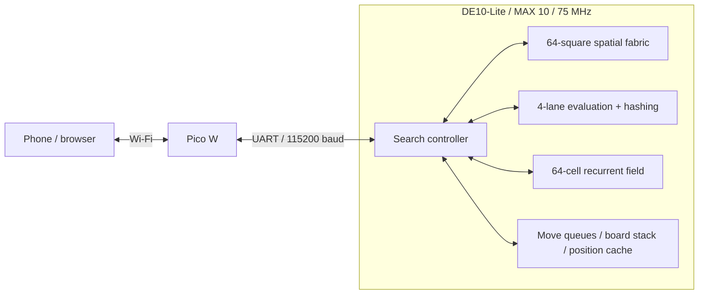

# DE10-Lite Chess

A chess engine in VHDL for the DE10-Lite. The FPGA generates legal moves,
evaluates positions and searches replies. A Pico W hosts the board over local
Wi-Fi, so you can play from a phone.

## How it thinks

### Spatial mode

A 64-cell recurrent field gives each square a signed value. Neighboring cells,
attack maps, programmable weights, bias and noise change the field over time.
The engine ranks legal moves using that field alongside captures, king safety,
activity and move-history preferences. This mode chooses a move without
searching a tree of replies. Speed round uses it when your clock runs out.

### Search mode

Search uses minimax with alpha-beta pruning: choose the best continuation,
assuming the opponent will do the same. A branch stops as soon as its bounds
show it cannot improve the decision.

Move ordering makes those cutoffs happen earlier. At the root, the previous
iteration's best move goes first. Inside the tree, cache hints, captures,
killer moves and quiet-move history guide the order. Root principal-variation
search (PVS) gives later candidates a narrow
scout window; a promising result gets a full-window re-search. A 4,096-entry
position cache reuses scores and preferred moves within the search. Capture
exchange analysis estimates a sequence of recaptures to improve move ordering.

At the horizon, evaluation combines material, piece placement, pawn structure,
bishop pairs, rook files, king shelter, king pressure and mobility. Middlegame
and endgame scores blend as material comes off. Quiescence follows captures
and promotions for up to four extra plies, with check evasions, so evaluation
doesn't stop halfway through a tactical exchange.

Iterative deepening starts at two plies and works toward the selected depth,
up to eight. A ply is one move by one player. The default is five ply with a
ten-second budget; if time expires, the last complete iteration supplies the
move. The console shows completed depth, searched nodes, cache answers,
candidate score bounds and the captured continuation.

## Architecture



The spatial fabric is wired chess geometry: sliding rays propagate through
empty squares and stop at occupied ones; knights, kings and pawns use fixed
connections. It produces White attacks, Black attacks and one selected
piece's reach map concurrently. Speculative moves pass a king-safety check.

There is **one spatial fabric and one search controller**. The controller
walks one branch at a time. Repeated work inside each node is parallel:
four evaluation/hash lanes, four move-queue banks, eight-square board restores
and two pawn-file arithmetic lanes. The controller advances every four clocks;
UART, RAM ports and capture exchange stages use the native clock.

The PLL raises the board's 50 MHz reference to **75 MHz**. The routed build
passes all timing corners with **+2.293 ns** worst setup margin, using 80% of
logic elements and 73% of M9Ks. [Build results](docs/build-results.txt) contain
the full numbers.

The browser handles the board, game history and clocks. It also independently
checks the FPGA's legal moves and resulting position. The Pico W serves the
page and bridges commands to UART. In self-play, both colors take turns using
the same FPGA engine.

## Play

Connect these **3.3 V** UART signals and share ground:

| Pico W | DE10-Lite GPIO header |
| --- | --- |
| GP0 / TX, physical pin 1 | GPIO[8] / RX, FPGA pin W6 |
| GP1 / RX, physical pin 2 | GPIO[4] / TX, FPGA pin V8 |
| GND | GND |

1. Program the DE10-Lite with [de10_chess.sof](output_files/de10_chess.sof)
   using Quartus Programmer. Select the 10M50 device.
2. Hold **BOOTSEL** while plugging in the Pico W, then copy
   [pico_chess.uf2](output_files/pico_chess.uf2) to its **RPI-RP2** drive.
   Arduino IDE upload also works; use the whole
   [sketch folder](firmware/pico_chess), including `web_page.h`.
3. Join **FPGA-Chess**, password **fpgachess**.
4. Open **http://192.168.4.1/**, wait for the FPGA connection and start a game.
   Pico USB serial at 115200 baud prints the address at startup.

Load both matching images. The SOF is volatile, so reload it after FPGA power
is cycled. If the page opens but the engine won't connect, check the crossed
TX/RX wires, press **KEY0**, then reconnect.

Play against the FPGA, watch FPGA vs FPGA, or use pass-and-play. In **Speed
round**, a missed deadline makes the FPGA play a Spatial move for you.
Captured pieces show traditional points: **1 / 3 / 3 / 5 / 9**. The engine
console shows measured cycle phases, search activity and the field heatmap.
Undo, promotion, board flipping and PGN export are included.

## Raspberry Pi / DE0-CV

For the **DE0-CV + Raspberry Pi SPI** port, the standalone [rpi folder](rpi/README.md)
contains the complete Pi app. Copy it to the Pi and run `python3 start.py`.
It keeps the Pi's existing network and sets up SPI on the first run.
This port requires the matching DE0-CV FPGA image.

Build its standalone ZIP with `python3 tools/package_rpi.py`.
The ZIP contains one flat `rpi/` folder and a SHA-256 manifest.

## Build and edit

Use Quartus Prime Lite 23.1 and Arduino-Pico core 6.0.0:

```powershell
powershell -ExecutionPolicy Bypass -File tools/build_fpga.ps1
powershell -ExecutionPolicy Bypass -File tools/build_pico.ps1
```

Outputs go into `output_files/`. The FPGA script checks timing before replacing
the programming images. Neither command uploads to a board.

For Arduino IDE, open [pico_chess.ino](firmware/pico_chess/pico_chess.ino) and
select **Raspberry Pi Pico W**, **133 MHz**, **Pico SDK USB**, **2 MB (no FS)**.
The committed `web_page.h` contains the page and artwork. After editing `web/`,
run `web/embed_web.ps1` before an IDE upload; `build_pico.ps1` does this for you.

## Source map

```text
rtl/          FPGA engine, spatial fabric, RAM, PLL and UART
firmware/     Pico W sketch and embedded webpage
web/          Editable board UI, chess rules and FPGA client
rpi/          Standalone Raspberry Pi SPI app for the DE0-CV port
sim/          RTL simulation benches
tests/        Independent rules, search and protocol checks
tools/        Build, program, package and verification scripts
docs/         Architecture, protocol and measured results
output_files/ Ready-to-program SOF, POF, UF2 and SHA-256 manifest
```

The Quartus project and constraints live at the root. Generated compiler
databases and local caches stay out of Git; the programming images and
Arduino-ready webpage stay in. Older plans and measurements live in
[docs/history/](docs/history).

[Documentation](docs/README.md) | [Search details](docs/ENGINE.md) |
[Hardware pipeline](docs/ADVANCED_ENGINE.md) | [Validation record](docs/VALIDATION.md)
