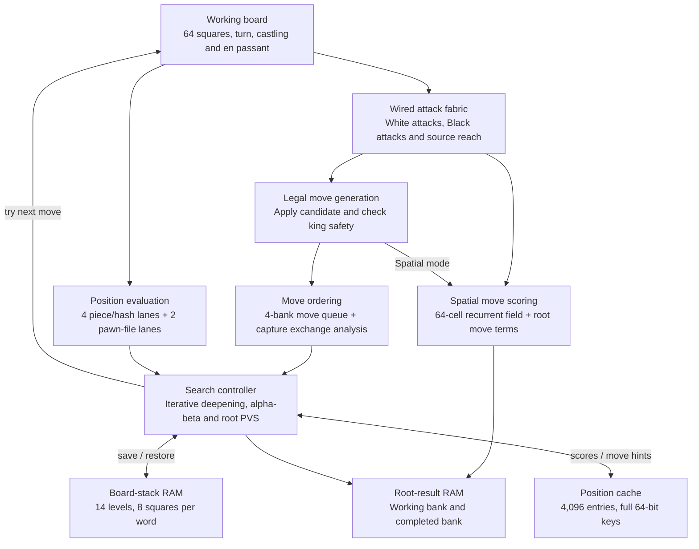

# DE10-Lite Chess

A chess engine written in VHDL for the DE10-Lite's MAX 10 FPGA. The hardware
generates legal moves, evaluates positions and searches for a reply. A Pico W
serves the board in a browser over local Wi-Fi.

## Features

- Play White or Black against the FPGA, watch it play both sides, or play locally
  with another person.
- Set search depth from 2 to 8 plies and choose a time limit. Defaults are
  5 plies and 10 seconds per move.
- Castling, en passant, all four promotion choices, undo and PGN export.
- View the searched line, move scores, completed depth, node count and time spent
  in each engine phase. Spatial mode has a board heatmap.
- Speed round gives the human a clock; on expiry, the FPGA makes a Spatial move
  for that side.

## Engine architecture

The engine uses one search controller and one working board. It tries a move,
checks the resulting position, searches the reply and restores the board before
trying the next branch. Parallel hardware handles attack maps, evaluation and
RAM access within that search.

### Move generation

The attack fabric is wired across all 64 squares. Rook, bishop and queen rays
pass through empty squares and stop at occupied ones. Pawns, knights and kings
use fixed connections. Three planes produce White attacks, Black attacks and
the selected piece's reach map at the same time.

The controller adds pawn pushes and castling, applies each candidate to the
working board, then checks whether its own king is attacked. Castling rook
movement, en-passant captures and promotion are handled before that check.
See [chess_spatial.vhd](rtl/chess_spatial.vhd) for the attack network.

### Search

Iterative deepening starts at two plies and works toward the chosen depth.
Alpha-beta pruning cuts off branches that cannot improve the result. The
previous iteration's best move goes first; later root moves use narrow
principal-variation search windows and get a full search if they might be better.

A 4,096-entry position cache reuses scores and supplies move-ordering hints.
Captures, promotions, killer moves and quiet-move history guide the remaining
order. The [capture exchange analyzer](rtl/chess_see.vhd) estimates recaptures
to help order defended captures. At the horizon, quiescence follows captures
and promotions for up to four more plies, with check evasions.

Two root-result RAM banks separate the current iteration from the last
completed one. If time expires partway through a deeper search, the completed
bank supplies the move. The first iteration is allowed to finish even if it
exceeds the time limit.

### Evaluation and memory

Four evaluation lanes process four squares per controller enable, with four
matching Zobrist ROM banks generating the position key. Evaluation combines
material, piece placement, pawn structure, bishop pairs, rook files, king
shelter, king pressure and mobility. Middlegame and endgame scores blend as
material comes off; two arithmetic lanes handle pawn-file terms.

M9K block RAM holds the position cache, per-level move queues, board stack and
root results. Board saves and restores transfer eight squares in each 32-bit
word. Four move-queue banks feed registered comparisons to select the next move.
Fourteen stack levels allow for normal search, quiescence and check evasions.

The controller and evaluation arithmetic are in
[chess_engine.vhd](rtl/chess_engine.vhd); the banked queues, cache, history and
hash ROMs are in [chess_search_memory.vhd](rtl/chess_search_memory.vhd).
[Search engine details](docs/ENGINE.md) cover scoring, draw handling and cache reuse.

### Spatial mode

Spatial mode chooses among legal moves without searching replies. A recurrent
field stores one signed value per square. Shared arithmetic updates those
values using neighboring cells, attack maps, programmable weights, bias and
noise, then the engine uses the field alongside capture and positional terms
to score each move. The field and its policy settings use
[chess_cell_memory.vhd](rtl/chess_cell_memory.vhd).

The wired attack fabric is shared by both modes. Search mode uses the searched
position score; Spatial mode uses the root move preferences. The console can
show the completed field snapshot in either mode.

## Playing

The Pico W hosts the page, scripts and piece artwork. Once connected, play
needs no internet access. The browser keeps game history and clocks, compares
the FPGA's legal moves with its own rules, and checks the board after the
chosen move is committed.

Connect these **3.3 V** UART signals and share ground:

| Pico W | DE10-Lite GPIO header |
| --- | --- |
| GP0 / TX, physical pin 1 | GPIO[8] / RX, FPGA pin W6 |
| GP1 / RX, physical pin 2 | GPIO[4] / TX, FPGA pin V8 |
| GND | GND |

1. Load [de10_chess.sof](output_files/de10_chess.sof) with Quartus Programmer.
   The device is **10M50DAF484C7G**.
2. Hold **BOOTSEL** while plugging in the Pico W, then copy
   [pico_chess.uf2](output_files/pico_chess.uf2) to its **RPI-RP2** drive.
3. Join **FPGA-Chess**, password **fpgachess**.
4. Open **http://192.168.4.1/** and wait for the FPGA connection.
   Pico USB serial at 115200 baud prints the address at startup.

Load matching FPGA and Pico images. Reload the SOF after the DE10-Lite loses
power. If the page opens but the engine does not connect, check TX/RX and
ground, press **KEY0** on the DE10-Lite and reconnect.

## FPGA footprint

The recorded October 24, 2026 implementation uses the board's 50 MHz reference
and a PLL to run at 75 MHz. The search controller advances every four clocks;
UART, RAM ports and the capture exchange pipeline use the native clock.

| Resource | Usage |
| --- | --- |
| Logic elements | 39,982 / 49,760 (80%) |
| M9K blocks | 133 / 182 (73%) |
| Worst setup slack | +2.293 ns |
| Minimum hold slack | +0.113 ns |

The [timing report](docs/build-results.txt) has the full resource and timing
figures. The [validation record](docs/VALIDATION.md) lists completed checks and
physical-board acceptance still to be done for these images.

## Source layout

| Path | Contents |
| --- | --- |
| [rtl/](rtl) | Engine, attack fabric, RAM, capture exchange analyzer, clock and UART |
| [firmware/pico_chess/](firmware/pico_chess) | Pico W web server and UART bridge |
| [web/](web) | Browser board, chess rules, FPGA client and artwork |
| [sim/](sim), [tests/](tests) | RTL testbenches, independent rule fixtures and search/protocol checks |
| [tools/](tools) | Build, programming and packaging scripts |
| [docs/](docs/README.md) | Detailed engine, pipeline and protocol documentation |
| [output_files/](output_files) | FPGA/Pico programming images and SHA-256 manifest |

The Quartus project, pin assignments and timing constraints are at the root.
