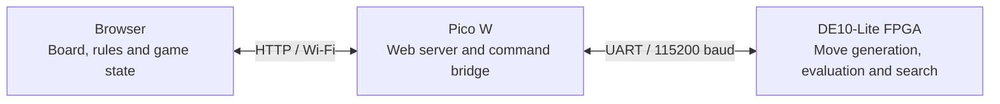

# DE10-Lite Chess

A hardware chess engine for the Terasic DE10-Lite, written in VHDL. Legal move
generation, position evaluation and search run on the MAX 10 FPGA. A Raspberry
Pi Pico W serves a local web interface, so you can play from a phone or browser
over Wi-Fi.

[Architecture](docs/ARCHITECTURE.md) · [Engine](docs/ENGINE.md) ·
[UART protocol](docs/UART_PROTOCOL.md) · [Validation](docs/VALIDATION.md)

## Features

- Play either color against the FPGA, watch FPGA self-play, or use pass-and-play.
- Search with iterative deepening and alpha-beta pruning, from 2 to 8 plies.
  The default is 5 plies with a 10-second budget.
- Switch to Spatial mode for move selection using a programmable 64-cell
  recurrent field. Speed round uses this mode when the human clock expires.
- Use touch or mouse controls, promotion choices, undo, board flipping and PGN
  export. The engine console shows search depth, nodes, timing and a field heatmap.

The page, scripts and piece artwork are stored on the Pico W. Play needs no
internet connection or external server.

## Architecture



| Component | Responsibility | Source |
| --- | --- | --- |
| Browser | Board controls, independent chess rules, game history, clocks and FPGA result verification | [web/](web) |
| Pico W | Wi-Fi access point, embedded webpage, HTTP requests and framed UART commands | [firmware/pico_chess/](firmware/pico_chess) |
| FPGA | Attack maps, legal moves, position evaluation, tree search and selected-move commit | [rtl/](rtl) |

The browser uploads a position and search settings. The FPGA chooses a move;
the browser checks the complete legal move set, validates the returned
continuation and requests a commit tied to that position's generation number.
It then reads the resulting board back before updating the game.

Inside the FPGA, one search controller explores one branch at a time. Parallel
hardware handles work within each node: wired attack maps across all 64 squares,
four evaluation/hash lanes, four move-queue banks, eight-square board restores
and two pawn-file arithmetic lanes. The [architecture breakdown](docs/ARCHITECTURE.md)
maps these blocks to their RTL and follows a move through the system.

## Engine design

Search uses iterative deepening, alpha-beta pruning and root principal-variation
search. A 4,096-entry position cache, capture exchange analysis, killer moves
and quiet-move history improve move ordering. Evaluation combines material,
piece placement, pawn structure, bishop pairs, rook files, king safety and
mobility, blending middlegame and endgame values. Quiescence follows captures
and promotions for up to four extra plies, with check evasions.

Each completed iteration publishes a full result set. If the time budget
expires during a later iteration, the previous completed result supplies the
move. The first iteration is allowed to finish even if it exceeds the budget.
Requested depth can therefore differ from completed depth.

Spatial mode ranks legal moves without searching replies. Its signed cell
values evolve from neighboring cells, attack maps, programmable weights, bias
and noise. The wired attack fabric and the recurrent field are separate parts
of the design. [Engine details](docs/ENGINE.md) cover scoring, draws, cache
reuse and result bounds.

## Hardware setup

You need a **DE10-Lite**, a **Raspberry Pi Pico W**, USB connections for power
and programming, and three jumper wires. Connect the UART signals below with
**3.3 V logic** and a shared ground:

| Pico W | DE10-Lite GPIO header |
| --- | --- |
| GP0 / TX, physical pin 1 | GPIO[8] / RX, FPGA pin W6 |
| GP1 / RX, physical pin 2 | GPIO[4] / TX, FPGA pin V8 |
| GND | GND |

1. Program the DE10-Lite with [de10_chess.sof](output_files/de10_chess.sof)
   using Quartus Programmer. Select the MAX 10 **10M50DAF484C7G** device.
2. Hold **BOOTSEL** while plugging in the Pico W, then copy
   [pico_chess.uf2](output_files/pico_chess.uf2) to its **RPI-RP2** drive.
3. On your phone or computer, join **FPGA-Chess**, password **fpgachess**.
4. Open **http://192.168.4.1/** and wait for the FPGA connection.
   Pico USB serial at 115200 baud prints the address at startup.

Use the FPGA and Pico images from the same checkout. The SOF is volatile;
reload it after the FPGA loses power. If the page opens but the engine does
not connect, check TX/RX and ground, press **KEY0** on the DE10-Lite and reconnect.

## Build and verify

The build scripts use Windows PowerShell. The recorded build uses **Quartus
Prime Lite 23.1std.1**, **Arduino CLI** and **Arduino-Pico core 6.0.0**. Run from
the repository root:

```powershell
powershell -ExecutionPolicy Bypass -File tools/build_fpga.ps1
powershell -ExecutionPolicy Bypass -File tools/build_pico.ps1
```

Outputs go into `output_files/`. The FPGA script compiles an isolated source
snapshot and checks timing at every available corner before replacing the
programming images. These commands build without programming either board.
Use `-Quartus` or `-ArduinoCli` to supply tool paths when needed.

For Arduino IDE, open [pico_chess.ino](firmware/pico_chess/pico_chess.ino) and
select **Raspberry Pi Pico W**, **133 MHz**, **Pico SDK USB**, **2 MB (no FS)**.
Edit the UI in `web/`; `build_pico.ps1` embeds it automatically. Before an IDE
upload, run `web/embed_web.ps1` to regenerate the committed `web_page.h`.

Verification uses Python, Node.js, GHDL and a C++ compiler. The setup script
downloads GHDL and the independent python-chess rules oracle into `.cache/`:

```powershell
powershell -ExecutionPolicy Bypass -File tools/setup_test_tools.ps1
powershell -ExecutionPolicy Bypass -File tools/verify.ps1
```

The verification script checks browser rules, UART framing, RTL move legality,
memory, arithmetic and search behavior. Add `-Browser` for the Chrome UI smoke
test or `-Strength` for the longer mate fixtures. These checks run without
physical boards; [validation](docs/VALIDATION.md) records their scope.

To build the portable project ZIP and refresh its SHA-256 manifest:

```powershell
powershell -ExecutionPolicy Bypass -File tools/package.ps1
```

## Recorded build

The October 24, 2026 routed build targets **10M50DAF484C7G**:

| Item | Result |
| --- | --- |
| Internal clock | 75 MHz from the board's 50 MHz reference |
| Logic elements | 39,982 / 49,760 (80%) |
| M9K blocks | 133 / 182 (73%) |
| Worst setup slack | +2.293 ns |
| Minimum hold slack | +0.113 ns |

See the [build report](docs/build-results.txt) for all timing corners and
resource figures. Physical-board UART/Wi-Fi acceptance for these images is
still pending; the [validation record](docs/VALIDATION.md) lists completed
checks and the board test procedure. Playing strength has no measured Elo rating.

## Repository layout

| Path | Contents |
| --- | --- |
| [rtl/](rtl) | Chess engine, spatial fabric, block RAM, exchange analyzer, PLL and UART |
| [firmware/pico_chess/](firmware/pico_chess) | Pico W sketch, protocol parser and generated embedded page |
| [web/](web) | Editable board UI, chess rules, FPGA client and artwork |
| [sim/](sim) | VHDL testbenches and the simulation-only fast attack model |
| [tests/](tests) | Independent rule fixtures, search comparisons and client/protocol checks |
| [tools/](tools) | Build, program, verify and package scripts |
| [docs/](docs/README.md) | Architecture, engine design, protocol and measured results |
| [output_files/](output_files) | SOF, POF, UF2 and source/image SHA-256 manifest |

The Quartus project, pin assignments and timing constraints are at the root.
Compiler databases and local dependencies stay out of Git. Earlier plans and
measurements are kept in [docs/history/](docs/history).
