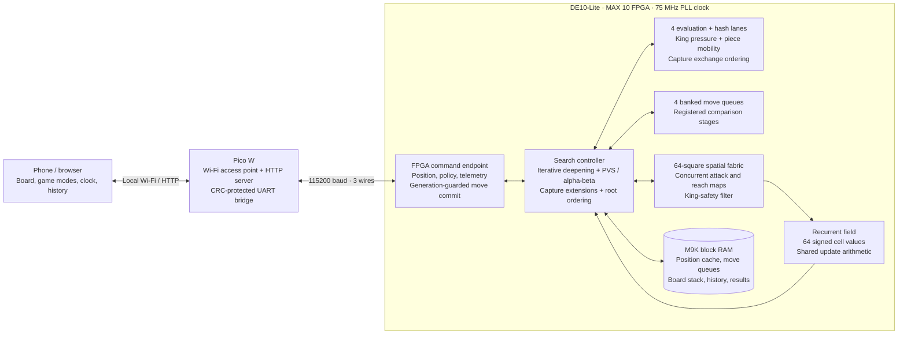

# FPGA Chess — DE10-Lite + Pico W

A self-contained port of Stochastic Chess to the **DE10-Lite (10M50DAF484C7G)**,
using the same **Pico W / 115200-baud UART / Wi-Fi webpage** workflow as the
oscilloscope example. All RTL, firmware, artwork, web files, and build scripts
are included here. Move this entire project folder wherever you want.

The FPGA generates legal moves, runs the recurrent field and up to eight-ply
search with capture extensions, and chooses the computer's move. The Pico W hosts its own Wi-Fi network
and serves the complete page from flash. The browser handles your moves,
history, draw rules, and an independent check of the FPGA's complete legal set.

## Architecture



**Your phone runs the game; the FPGA chooses computer moves.** The browser
keeps the board, rules, move history, captures and clocks. The Pico W serves
that page from flash and translates HTTP requests into UART packets. It does
not evaluate chess positions. FPGA vs FPGA sends both colors to the same
hardware engine, one turn at a time.

Inside the FPGA, the spatial fabric computes attack and reach maps through
parallel connections between squares. A shared controller uses those maps to
generate moves, reject moves that expose its king, and search replies. The
search walks one speculative board at a time; block RAM stores the board
stack, ordered moves and previously visited positions. The recurrent field's
64 cell values use shared update arithmetic. Spatial mode ranks moves with
that field; search mode uses consistent searched position values. There is
one spatial fabric and one search controller, with parallel datapaths inside.

A computer turn follows this path:

1. Load the position, search settings and recent moves onto the FPGA.
2. Settle the recurrent field and generate legal root moves.
3. Search progressively deeper, trying the previous best move first and using
   scout windows, alpha-beta and the position cache. The newest **complete**
   iteration supplies the result.
4. Return candidates with exact/bound labels, a continuation prefix, measured
   phase counters and a field snapshot to the browser.
5. Compare the complete FPGA legal set with the browser's independent rules,
   commit the FPGA-selected move with its position generation, and check the
   resulting board before showing it.

The board's 50 MHz oscillator feeds a PLL for the **75 MHz internal clock**,
a 50% frequency increase. Setup, hold, recovery and removal pass at every
available timing corner; worst setup slack is **2.293 ns**.
The search controller advances once every four internal clocks to accommodate
RAM and combinational paths; the spatial wiring works
in parallel between those steps. The destination scanner uses the reach map
to skip impossible squares. Pawn pushes and castling are explicitly included
before the ordinary legality checks. This reduces work per searched node
without increasing the requested depth or removing moves.

The datapath now restores **eight squares together**, computes all source
eligibility bits concurrently, and evaluates **two pawn files in parallel**.
It also evaluates **four squares together**, reads **four hash banks** and
selects moves from **four queue banks** through registered comparison stages.
Long controller decoding ends at enabled request registers; short native-clock
strobes drive RAM writes and exchange analysis. This addresses measured
critical paths before increasing frequency. See
[docs/ADVANCED_ENGINE.md](docs/ADVANCED_ENGINE.md) for the pipeline and
[docs/build-results.txt](docs/build-results.txt) for qualified timing/resources.

See [docs/ARCHITECTURE.md](docs/ARCHITECTURE.md) for a source map, a worked
example and the console's measurements. The original
[engine advancement plan](docs/ENGINE_ROADMAP.md) records the rationale for
the stages now implemented.

## Play

1. Load **`output_files/de10_chess.sof`** onto the DE10-Lite with Quartus
   Programmer, or run `tools/program_fpga.ps1`. Select the **10M50** device.
   The SOF configures volatile SRAM; reload it after cycling FPGA power.
2. Hold **BOOTSEL** while connecting the **Pico W** to USB. Copy
   **`output_files/pico_chess.uf2`** to the **RPI-RP2** drive. It reboots into
   the chess firmware.
3. Connect the same three UART wires as the example:

   | Pico W | DE10-Lite |
   | --- | --- |
   | **GP0 / TX** (physical pin 1) | **GPIO[8] / RX**, FPGA pin **W6** |
   | **GP1 / RX** (physical pin 2) | **GPIO[4] / TX**, FPGA pin **V8** |
   | **GND** | **GND** |

   These are **3.3 V logic** signals. Power each board through its normal USB
   supply and share ground. GPIO labels refer to the DE10-Lite GPIO header.
4. Connect your phone or computer to **`FPGA-Chess`**, password **`fpgachess`**.
5. Open **<http://192.168.4.1/>** with the included Pico W build. USB serial at
   **115200 baud** prints the actual address as `Open http://...` at startup.
6. Wait for **FPGA connected**, select your color, and press **New game**.
   Choose a piece and destination. Black starts with the FPGA playing white.

The page includes all four promotions, undo, board flipping, game restoration
after reload, PGN download, checkmate/stalemate, automatic draw rules, and
threefold/fifty-move draw claims. Lookahead includes Spatial and 2 through 8 ply;
the default targets **5 ply with a 10-second think budget**. Choose 3, 10, 20,
or 30 seconds. The FPGA keeps the last complete iteration if time runs out,
and the page shows the completed depth and cache reuse. The first complete
iteration can exceed a very short budget. **Play FPGA turn** resumes after a
stopped search or a reconnect.
Saved history is local to your browser; use one controlling browser tab.

### Game modes and mobile controls

| Mode | How it plays |
| --- | --- |
| You vs FPGA | Choose White or Black and play the hardware engine. |
| FPGA vs FPGA | Watch the same FPGA play both sides; pause and resume at any time. |
| Pass & play | Two people share the board. Moves work even if the FPGA is disconnected. |
| Speed round | Each human turn gets 5, 10, 15 or 30 seconds. At zero, the FPGA chooses a **Spatial** move for you, then searches its own reply at the selected depth. |

Choose a mode and press **New game**. Mode, color and move timer changes apply
to a new game; depth and think budget apply to the next FPGA turn. A speed
clock starts after the FPGA's reply is verified, and keeps running while you
choose a promotion. A timed-out promotion is canceled before the FPGA takes
over. Clock expiry is checked when the page can run again after background
suspension; keep the controlling page open for timely moves. Speed and self-play
games restore **paused** after a reload. **Undo move** removes one ply in
pass-and-play/self-play; speed-round undo pauses the game.

**Off the board** shows the pieces actually captured by each color, with
traditional values: pawn **1**, knight **3**, bishop **3**, rook **5**, queen
**9**. Each tray totals capture points. The material balance counts the pieces
currently on the board, so promotions affect it correctly. En passant, capture
promotions, undo and reload use the recorded game positions.

The engine console below the game shows measured decision time, nodes, depth,
node rate, alpha-beta cutoffs, cache matches/answers/writes, root re-searches,
capture exchange calls, device clock and deepest visited ply. A measured phase
bar breaks down where FPGA cycles went. Its trace uses UART samples, and its
heatmap is the **last completed
recurrent-field snapshot**, with White at the bottom. Candidate scores and the
chosen move's seven components come from the FPGA. Search candidates distinguish
exact values from upper bounds; the captured continuation is checked for legal
moves. Scores are not win probabilities or a calibrated evaluation bar.

Wi-Fi startup matches the oscilloscope reference: `WiFi.softAP(...)` uses the
Pico library's default AP configuration. The sketch does not force the mode or
IP address. The installed Arduino-Pico 6.0.0 library defaults to `192.168.4.1`;
another core version may choose a different address. The phone's Router/Gateway
address is also the Pico's address. The hotspot serves the local game without
internet access, so a phone may still ask whether to stay on an offline network.
Matching the reference's IP does not guarantee that this phone prompt disappears.

Dark mode is the default; the header's light/dark toggle remembers your choice.
Drag pieces with a mouse or finger, or tap a piece and its destination. Illegal
and off-board drops leave the piece in place, and promotions still offer all
four pieces. The page stays still for gestures that start on the board; start a
swipe outside the board to scroll the page.

The engine uses a **4,096-entry position cache in M9K block RAM**, iterative
deepening, root principal-variation search and up to four capture/promotion
extension plies with check evasions. Evaluation blends middlegame and endgame
placement, pawn structure, bishop pairs, rook files and shelter, with new
king-zone pressure and per-piece mobility terms. Capture exchange analysis
improves ordering without removing legal choices.

[docs/advancement-results.json](docs/advancement-results.json) isolates
evaluation lanes, root scheduling and queue banking against reference RTL.
On its two deterministic fork/promotion fixtures, those stages reduce decision
cycles from **1,573,992 to 276,828 (82.4% fewer)** while preserving the exact
best values and valid candidate bounds. New positional terms and exchange
ordering are disabled for that isolated comparison.
[docs/VALIDATION.md](docs/VALIDATION.md) records timing, tactics, depth-eight
search, deadline and browser checks. Earlier measurements remain in
[parallel-results.json](docs/parallel-results.json) and
[strength-results.json](docs/strength-results.json), with their original scope.
Cycle savings and tactical regressions do not establish an Elo gain; equal-time
games would measure that. See [docs/ENGINE.md](docs/ENGINE.md) for controls.
Load **both matching FPGA and Pico images** for protocol 5 and the new console.

The routed design uses **39,982 / 49,760 logic elements (80%)**, **987,168
memory bits (59%)**, **133 / 182 M9Ks (73%)**, 73 nine-bit DSP elements and one
PLL. This task built the images without programming the physical boards.

**KEY0** resets the endpoint. **KEY1** starts evaluation on the currently loaded
position for bench diagnostics. LEDR9 indicates engine activity, LEDR8 the side
to move (off: white, on: black), and LEDR7..0 the recurrent field. HEX3..0 show
the encoded selected move; HEX4 shows part of the legal count and HEX5 the FSM
state nibble.

## Build

Prebuilt FPGA images (`de10_chess.sof` and `de10_chess.pof`) and Pico W firmware
(`pico_chess.uf2`) are included in `output_files/`, along with a SHA-256 manifest
for the project files and all three images.

From this project folder, with Quartus Prime Lite 23.1 and the Arduino Pico
core **6.0.0** installed:

```powershell
powershell -ExecutionPolicy Bypass -File tools/build_fpga.ps1
powershell -ExecutionPolicy Bypass -File tools/build_pico.ps1
```

The scripts produce the SOF, POF, and UF2 in `output_files/`. Builds never upload
automatically. `build_fpga.ps1` builds an isolated source snapshot and promotes
images only after setup/hold/recovery/removal, external timing coverage and
source-hash checks pass. Failed candidates stay in `.cache/`. Both scripts use
paths relative to their own project; their executable paths can be overridden.

Run `powershell -ExecutionPolicy Bypass -File tools/package.ps1` after building
to refresh `output_files/build_manifest.json` and create a portable
`output_files/DE10LiteChess.zip`. Git tracks the programming images and manifest;
compiler databases, temporary reports, and the ZIP are ignored.

In Arduino IDE, select **Raspberry Pi Pico W**, **133 MHz**, **Pico SDK USB**,
**2 MB (no FS)**, and open `firmware/pico_chess/pico_chess.ino`. The generated
`web_page.h` already contains the page and chess artwork. After editing `web/`,
run `web/embed_web.ps1` or the Pico build script to regenerate it.

Edit `WIFI_NAME` and `WIFI_PASSWORD` in the sketch and rebuild to customize the
network. USB serial at 115200 prints the AP address at startup.

## Validate

See [docs/VALIDATION.md](docs/VALIDATION.md) for the measured build and test
results and the remaining physical-board checks.

```powershell
# Optional portable test tools: GHDL and python-chess, downloaded into .cache/.
powershell -ExecutionPolicy Bypass -File tools/setup_test_tools.ps1
powershell -ExecutionPolicy Bypass -File tools/verify.ps1
# Add the independently proven five-ply mate benchmark (longer simulation).
powershell -ExecutionPolicy Bypass -File tools/verify.ps1 -Strength
```

Verification uses Python 3.10+, `python-chess`, Node.js 18+, GHDL, and a native
C++11 compiler. `verify.ps1` accepts explicit executable paths and finds the
portable simulator, the local test dependency, VS Code's Node runtime, and
Questa's bundled GCC when installed here. No test imports the reference projects.
The browser smoke test uses Chrome and an explicitly simulated endpoint; it
checks UI behavior and is separate from physical FPGA acceptance.

See [docs/UART_PROTOCOL.md](docs/UART_PROTOCOL.md) for the binary transport and
engine command table. Pico W access-point support follows the
[Arduino-Pico Wi-Fi documentation](https://arduino-pico.readthedocs.io/en/latest/wifi.html).

## If the page opens but the FPGA does not connect

Check that both matching images are loaded, that **GP0 goes to GPIO[8]** and
**GP1 goes to GPIO[4]**, and that the grounds are joined. Press KEY0, then
**Reconnect**. The page reports UART failures and lets you retry the FPGA turn.
Use the Pico W, rather than a Pico without Wi-Fi.
