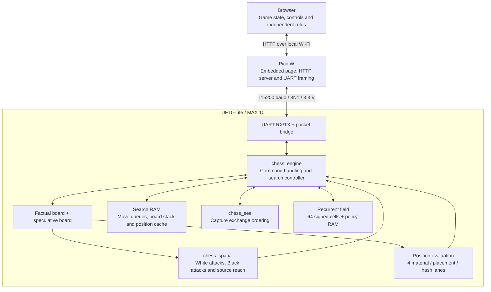

# System architecture

The DE10-Lite runs the chess engine in FPGA logic. The Pico W connects that
engine to a browser over local Wi-Fi, and the browser owns the game interface
and independently checks the hardware's results.

## System overview

Evaluation and recurrent-field sequencing are implemented inside
`chess_engine.vhd`; the diagram separates their functions. There is one search
controller, one speculative board and one spatial fabric. Self-play alternates
colors through that same engine.

## Browser and Pico W

| Layer | Responsibility | Main source |
| --- | --- | --- |
| Chess rules | Legal moves, position updates, SAN/PGN and game-level draw rules | [web/chess.js](../web/chess.js) |
| Game interface | Board gestures, history, captures, game modes, clocks and engine console | [web/app.js](../web/app.js), [web/style.css](../web/style.css) |
| FPGA client | Command queue, settings/position upload, status polling, result verification and guarded commit | [web/fpga.js](../web/fpga.js) |
| Pico firmware | Wi-Fi access point, HTTP server, UART framing, timeouts and retries | [pico_chess.ino](../firmware/pico_chess/pico_chess.ino), [chess_protocol.h](../firmware/pico_chess/chess_protocol.h) |

The editable page lives in `web/`. [embed_web.ps1](../web/embed_web.ps1) bundles
HTML, CSS, JavaScript and piece artwork into `web_page.h`, which is compiled
into Pico flash. The browser loads the page locally and sends chess commands;
the Pico does not render or stream the board display.

`POST /api/command` carries hexadecimal command bytes. The Pico frames them
for UART with a sequence number and CRC-16, then returns the FPGA's status and
payload as JSON. It retries an unanswered request with the same sequence;
mutation tokens prevent consecutive retries from applying the command twice.
Only one UART command/reply is in flight, while the FPGA evaluator can continue
running between commands. Byte layouts and limits are in the
[UART protocol](UART_PROTOCOL.md).

## FPGA modules

| Source | Role |
| --- | --- |
| [de10_chess.vhd](../rtl/de10_chess.vhd) | Top level: clock/reset, synchronized keys, UART instances, LEDs and seven-segment displays |
| [chess_clock.vhd](../rtl/chess_clock.vhd) | PLL generating the internal clock from the board's 50 MHz reference |
| [uart_rx.v](../rtl/uart_rx.v), [uart_tx.v](../rtl/uart_tx.v) | Serial byte reception and transmission |
| [chess_uart_bridge.vhd](../rtl/chess_uart_bridge.vhd) | Packet framing/CRC, request dispatch, retry handling and reply snapshots |
| [chess_pkg.vhd](../rtl/chess_pkg.vhd) | Board/move types, search limits, policy defaults and shared arithmetic helpers |
| [chess_engine.vhd](../rtl/chess_engine.vhd) | Board state, legal-move filtering, evaluation, iterative search, field updates, result publication and commit |
| [chess_spatial.vhd](../rtl/chess_spatial.vhd) | Concurrent White/Black attack maps and reachability for one selected source square |
| [chess_search_memory.vhd](../rtl/chess_search_memory.vhd) | Banked move queues, position cache, quiet history and Zobrist key ROMs |
| [chess_cell_memory.vhd](../rtl/chess_cell_memory.vhd) | Dual-port policy and recurrent-cell RAM |
| [chess_see.vhd](../rtl/chess_see.vhd) | Bounded capture/recapture analysis used to order moves |

### Board state and legality

The engine keeps a factual board for the uploaded position and a speculative
board for trying moves. Search changes the speculative board, then saves and
restores it through a packed board stack. The factual board changes only on a
position-changing command, such as upload, reset or accepted commit.

The spatial fabric has three wired planes: White attacks, Black attacks and
the selected piece's reach map. Sliding rays pass through empty squares and
stop at occupied squares; pawns, knights and kings use fixed local connections.
Pawn pushes and castling destinations are added by the move generator.

Each candidate is applied to the speculative board and checked for king
safety. Castling rook movement, en-passant captures, all four promotions, side
to move and castling rights follow the same save/restore path. Reachability
alone does not establish that a move is legal.

### Search and Spatial modes

Search uses iterative deepening from two plies toward the selected depth,
up to eight. Alpha-beta pruning, root principal-variation search, cache hints,
capture ordering, killer moves and quiet history reduce the explored tree.
Quiescence follows captures/promotions for up to four further plies and allows
check evasions. [ENGINE.md](ENGINE.md) explains evaluation, draws and bounds.

Each iteration writes to a separate root-results bank. Finishing an iteration
publishes its candidates, selected move, score, bound metadata and captured
continuation together. A deadline during the next iteration preserves that
completed bank. The first iteration can exceed the budget so that a result
still contains the complete legal root set.

The recurrent field holds a signed value for each square. Shared arithmetic
updates these values from neighbors, attack information, weights, bias and
pseudorandom input. Spatial mode uses the field to rank legal root moves
without a tree search. Search mode uses positional evaluation without adding
field, habit or random bonuses to its searched value. The console can show the
completed field snapshot in either mode.

## A turn from upload to commit

After the human plays **e2-e4**, the browser requests a Black reply:

1. **Upload.** Stop any earlier evaluation, apply depth/time settings and send
   the 64-square position, side to move, castling rights and en-passant square.
   Recent moves are sent for move-history preferences.
2. **Evaluate.** The FPGA settles the recurrent field, generates legal replies
   and runs the selected decision mode. Search publishes completed iterations.
3. **Poll.** The browser reads status about every 120 ms and telemetry about
   every 500 ms. The engine reports its clock, cycles, nodes and completed depth.
4. **Verify.** The browser reads back the uploaded position, compares the
   complete FPGA legal set with its own, checks candidate depth/bounds, legally
   replays the captured continuation and checks the selected explanation.
5. **Commit.** The browser sends the chosen move and position generation.
   The FPGA rejects a stale generation or a move other than the selected one.
6. **Read back.** The browser compares the resulting board with its expected
   position before recording the engine's move in the game.

The selected search move must have an exact score. A losing root scout may
carry an upper bound, so candidate scores are not all exact runner-up values.
A cached result can shorten the captured continuation; the UI displays the
available prefix.

## Parallel work and clocking

The controller walks one search branch at a time. The following hardware
accelerates operations repeated within that branch:

| Operation | Production implementation |
| --- | --- |
| Attack maps | Three concurrent wired planes across 64 squares |
| Source selection | A parallel mask identifies eligible source pieces |
| Destination selection | A reach-map scan skips impossible destinations |
| Board save/restore | Eight squares per 32-bit word; 16 controller enables to restore a board |
| Material, placement and hashing | Four square lanes with matching hash-ROM banks |
| Pawn-file evaluation | Two arithmetic lanes |
| Ordered-move selection | Four RAM banks with registered pair/group comparisons |

The PLL raises the 50 MHz board reference to **75 MHz**. The controller advances
on a common enable every four internal clocks. UART, RAM ports, queue comparison
stages and capture exchange analysis use the native clock. Reset asserts on
KEY0 or loss of PLL lock and releases through a synchronizer.

The timing constraints apply paired four-cycle setup/three-cycle hold exceptions
only to the identified common-enable registers. Native-clock stages retain
single-cycle requirements. The reported internal frequency is used for UART
divisors, FPGA budgets and the browser's conversion of cycle counts to seconds.
See [ADVANCED_ENGINE.md](ADVANCED_ENGINE.md) for pipeline boundaries and
[PARALLEL_ARCHITECTURE.md](PARALLEL_ARCHITECTURE.md) for scalar comparisons.

## Memory organization

Search state uses synchronous MAX 10 M9K RAM. The main logical capacities are:

| Storage | Capacity | Purpose |
| --- | --- | --- |
| Position cache | 4,096 × 128 bits | Full position key, depth, bound, preferred move and validity epoch |
| Move queues | 14 × 512 × 32 bits | Ordered moves at each search level, split across four banks |
| Board stack | 14 × 8 × 32 bits | Packed speculative boards |
| Quiet history | 4,096 × 13 bits | Source/destination cutoff history |
| Zobrist ROM | 1,024 × 64 bits | Position hashing constants, split across four banks |
| Root results | 2 × 256 × 144 bits | Published and in-progress candidate explanations |
| Root metadata | 2 × 256 × 8 bits | Candidate bound kind and completed depth |
| Continuations | 14 × 228 bits | Captured line prefixes |
| Recurrent cells / policy | 64 × 8 / 128 × 8 bits | Field values and programmable settings |

The position key includes board contents, side to move, castling rights and
en passant. A full-key match can supply a search answer or just a move-ordering
hint. Depth, quiescence and remaining-stack allowances constrain reuse; an
epoch prevents scored reuse across unrelated evaluations. Mate-distance and
repetition handling are described in [ENGINE.md](ENGINE.md).

## Game modes and observability

Self-play repeats the same upload/search/verify/commit path for alternating
colors. Pass-and-play uses browser rules without FPGA search. In speed round,
the browser owns the human clock and requests a Spatial move on expiry, using
the same verification and guarded commit. The next opponent turn restores the
chosen search settings.

Decision time and seven phase counters are 48 bits. The phase counters reconcile
with a coherent cycle snapshot; node rate uses FPGA time rather than HTTP
round-trip time. Telemetry also reports cache answers, root re-searches,
exchange calls, lane widths and deepest visited ply. The field heatmap is the
last completed snapshot. Live samples include polling and transport delay.

The [build report](build-results.txt) records fitted resources and routed
timing. The [validation record](VALIDATION.md) separates completed simulation
and client checks from pending physical-board acceptance.
