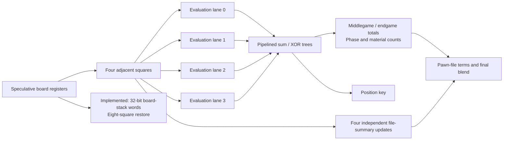

# Expanding the parallel datapath

The goal is to reduce the controller steps repeated at every searched position.
The recurrent field settles once per decision; speeding it up would remove
little of a multi-second search. Board restore, move generation, evaluation,
hashing and move ordering recur throughout the tree.

## First stage: wide restore, concurrent source selection and paired arithmetic

The speculative board already lives in registers, so several squares can be
restored simultaneously. The stack now stores eight adjacent 4-bit pieces per
32-bit RAM word. Each board is eight words, and twelve stack levels hold the
same 3,072 logical bits as before.

| Operation | Previous architecture | Implemented datapath |
| --- | --- | --- |
| Stack layout | 768 words x 4 bits | 96 words x 32 bits |
| Restore payload | One square | Eight squares, one rank |
| Restore microsteps | 64 reads/writes x 2 = 128 enables | 8 reads/writes x 2 = 16 enables |
| Restore time at current enable | 10.24 microseconds | 1.28 microseconds |
| Eligible sources | Visit all squares through the controller | Decode all 64 squares concurrently; select the next eligible source |
| Destination enumeration | Reach-map bit selection | Same reach-map bit selection |
| Pawn-file arithmetic | One file per enable, eight steps | Two files in parallel, four steps |
| Save/evaluation pass | One square per enable | Still one square per enable; packed RAM writes occur every eight squares |

The source mask derives piece occupancy and color directly from all board
registers. Its priority encoder preserves ascending square order. The existing
destination map, promotions and king-safety filter still validate moves.

Two pawn-file arithmetic lanes also evaluate independent files simultaneously
at every search node. They compute isolated/doubled/passed pawns, rook files,
king-file exposure and the existing bishop-pair term. Each file is weighted and
rounded separately before summing, so combining lanes preserves signed rounding.

The eightfold figure applies to the **restore operation**, not the complete
engine. Independent comparisons measure total decision cycles separately.
`STACK_LANES=1, FAST_SOURCES=false, PAWN_LANES=1` recreates the previous
datapath; production defaults to eight stack lanes, concurrent source selection
and two pawn-file arithmetic lanes.

The fitted design uses **30,949 / 49,760 logic elements (62%)**, compared with
29,399 (59%) in `8e713ca`. Memory stays at **917,128 bits and 125 / 182 M9K
blocks**. The packed stack is inferred as **96 x 32 bits in one M9K**. DSP use
is 45 of the 288 nine-bit multiplier elements. Setup/hold/recovery/removal
timing passes at every available corner at the existing 50 MHz clock.

The deterministic three-ply fork/promotion pair measures each change separately:

| Datapath | Total FPGA decision cycles |
| --- | ---: |
| Previous: one-square restore, sequential sources, one pawn-file lane | 3,582,792 |
| Eight-square restore | 2,126,344 |
| Plus parallel source mask | 1,556,760 |
| Plus two pawn-file arithmetic lanes | 1,533,784 |

That is **57.19% fewer cycles** or **2.336x throughput** for this pair, with the
same scores, selected moves, search-node counts and cache-match counts. All
variants use the same reach-map destination scanner, cache and search depth.
Random root preferences and recurrent-field relaxation are disabled. This
measures datapath efficiency, not a win-rate gain or a guaranteed whole-game
speedup. See [parallel-results.json](parallel-results.json).

## Next stage: four evaluation lanes

The current `SEARCH_SAVE` path visits all 64 squares to evaluate material and
piece placement, accumulate the position hash, count material, and build pawn
file summaries. A practical next design processes four adjacent squares at once:

Each lane computes material, middlegame/endgame piece placement, phase and pawn
shelter. A balanced reduction tree combines the contributions. Four adjacent
squares have distinct files, allowing four file summaries to update without
competing for the same file counter.

The Zobrist ROM also needs four simultaneous reads. Partitioning keys by square
index modulo four gives one distinct bank per lane. Merely adding arithmetic
units while keeping one ROM port would leave that port as the bottleneck.
The table keeps the same logical key contents; physical block packing must be
checked in Quartus.

This reduces 64 evaluation issue steps to 16 groups, plus pipeline fill/drain.
The actual latency, logic, DSP use and memory packing need a fitted design.
Per-piece weighting and rounding must happen before the reduction so cached
scores preserve their current meaning. Pawn terms, bishop-pair terms,
insufficient-material detection and hash salts must remain identical.

This stage is **planned**, not implemented in the current RTL.

## Following stage: wider move selection

Currently, selecting the next ordered move scans a RAM queue one entry at a
time. Four interleaved queue banks could read four entries per controller step.
A comparator tree would select the best priority and preserve the current
lowest-index tie rule. The last partial group must mask invalid lanes, and the
remove-by-swap operation must still use the correct last queue entry.

This attacks another per-node loop. Queue ports and bank packing need to be
designed together with the arithmetic; a four-way comparator alone does not
provide four reads from a single-port RAM.

This stage is also **planned**.

## Search scheduling and limits

The search still needs a result from one child before updating alpha/beta and
deciding whether to search another child. Faster per-position hardware removes
work around that dependency. Multiple independent search engines would also
need separate speculative boards, spatial fabrics and memory access paths.
The previous fitted release used 59% of logic and 125 of 182 M9K blocks, so
selective datapath widening is a sensible first step before full replication.

Root move ordering and shared root bounds can reduce how many nodes must be
visited. Those algorithm changes complement the parallel datapath; they also
require the candidate display/protocol to distinguish score bounds from exact
scores when a candidate is pruned.

Success is a faster complete evaluation or more completed depth under the same
time budget, within the device and timing limits. Deterministic equivalence
checks protect chess behavior; they do not establish a win-rate improvement.
